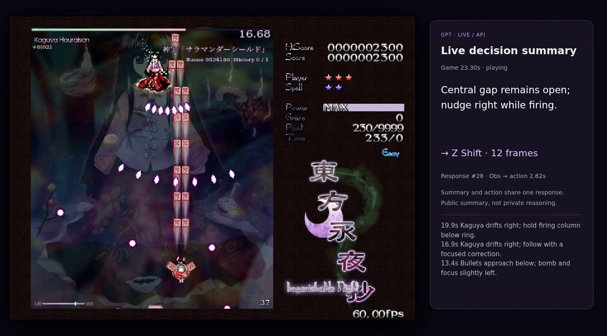

# sooool — SOL realtime autoresearch

A visual-control research loop for **gpt-6.1-sol / low**: profile API latency, develop a policy with subscription calls in a delayed simulator, inspect failures, freeze a candidate, and evaluate it while the real game keeps running.

The featured case is Touhou/Kaguya. The selected controller is the **early `tracking_dodge_safe_intercept_v2` checkpoint**, with native English public decision summaries. SOL chooses every direction, shot, focus, bomb and duration; the executor only validates and mechanically applies a response. A human supplied the task, budget, behavior feedback and a demonstrated trajectory. No model weights were trained.



**Read the research:** [how v2 was developed and selected](docs/touhou-research-record.md) · [development workflow](docs/touhou-development.md) · [evaluation records](docs/evaluation-records.md).

## Run an actual realtime evaluation

Linux, Python 3.10–3.12 and Chromium-compatible dependencies are required. Install Noto CJK fonts if Japanese/Chinese glyphs are unavailable.

```bash
uv sync --locked --python 3.12
uv run playwright install --with-deps chromium
uv run sol doctor --game touhou

# Reads OPENAI_API_KEY from process memory or prompts without echo.
# New run, explicit $5 ledger cap, at most 100 requests; no inference-time pause.
uv run sol eval touhou --seed 1 --budget-usd 5 --max-calls 100 \
  --output runs/touhou-api-001
```

This is the implemented API path. A fresh full-game paid validation of this new launcher is pending; historical source-harness results are labeled separately. It records complete model inputs/public outputs, applied actions, browser clocks, video, cost and a machine-readable `record.json`. A complete legal summary/action pair can apply before stream termination; all other requests still drain and settle. Only verified boss defeat at 1× is realtime acceptance. Survival, interrupted accounting and replay are distinct outcomes.

Budgets apply to the chosen ledger, including conservative in-flight reservations. A run gets its own ledger by default; `--ledger ...` explicitly selects a shared **cumulative** budget. Credentials are never command arguments or saved in runs. See [realtime details](docs/realtime.md).

## Develop in the simulator

```bash
codex login
uv run sol simulate touhou --seed 9 --output runs/touhou-dev-001
uv run sol record runs/touhou-dev-001
```

Development uses real subscription model decisions under an imposed historical/modeled API delay condition. Virtual game time waits at scheduled delivery events if model computation takes longer. There is **no paid API fallback**. These results are not actual realtime API acceptance. The current development and realtime recipes share the selected v2 gameplay strategy and English output schema; their timing modes differ.

The tested portable native executable is `codex-cli 0.162.1`. `SOL_CODEX_BIN` and `SOL_CODEX_HOME` select an executable and existing ChatGPT login; auth is not copied. `SOL_QUOTA_STOP_PERCENT` defaults to 80. An interrupted episode remains interrupted. Other native versions need compatibility checks.

## Profile and retain the evidence

```bash
# Strictly serial, unique retained task inputs; executes no game actions.
uv run sol profile touhou --episode runs/touhou-api-001/episode \
  --budget-usd 2 --max-calls 21 --output runs/touhou-profile-001

# Immutable, idempotent append; divergent records cannot overwrite a run ID.
uv run sol record runs/touhou-api-001 \
  --registry artifacts/touhou/evaluations.jsonl
```

The [record index](artifacts/touhou/evaluations.jsonl) includes completed defeats, survival without defeat, the prior portable simulation loss, and an interrupted budget attempt. Source-harness demos and fresh portable CLI evaluations are labeled separately. The source-harness English four-way demo defeated Kaguya at 58.47 game seconds with two hits; its 2.35s median capture-to-apply latency did not improve on the two-way demo's 2.32s. Both are single seen-seed observations, not a stable win-rate claim.

Large videos and input archives are optional and checksummed in [the evidence index](artifacts/README.md); the source package runs without downloading them. Public summary text is generated together with the selected action. It is not an internal reasoning transcript. Video postproduction, including added BGM, is disclosed per artifact.

## Repository map

- `recipes/touhou.json`: subscription development with a declared timing model.
- `recipes/touhou-realtime.json`: continuous 1× API evaluation and native English summaries.
- `policies/touhou/tracking-safe-intercept-v2/`: selected text, provenance and task compatibility fixtures.
- `runtime/`: portable transport, explicit launch commands, serial profiling and evaluation records.
- `environments/touhou/`: original browser/Gym engine, evaluator and timing/executor contracts.
- `profiles/touhou/`: measurements and explicitly modeled timing conditions.
- `artifacts/touhou/`: retained development gates and auditable evaluation outcomes.

Rhythm and Asterix remain supported through `sol simulate rhythm` and `sol simulate asterix`; Asterix selects V28. Racing retains its separate selected lane-commit policy and `sol eval racing` API path; see [Racing setup and evaluation](docs/racing.md). PingPong checkpoints remain research material. Their [validation](docs/validation.md), [timing semantics](docs/timing.md) and [historical checkpoint](docs/update-2026-10-16.md) are retained. Cleanup here removes duplicate/unselected Touhou snapshots from the active package rather than removing other games.

[Source/media provenance](docs/provenance.md). Repository access does not imply an additional license for upstream game materials.
