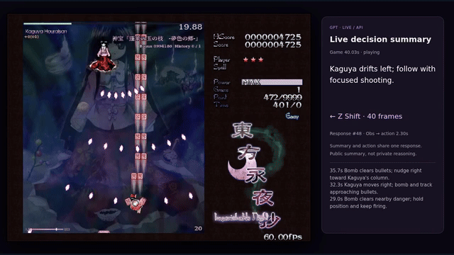
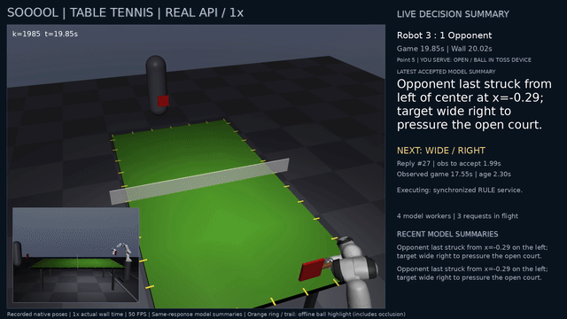
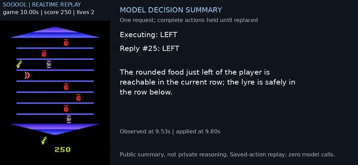
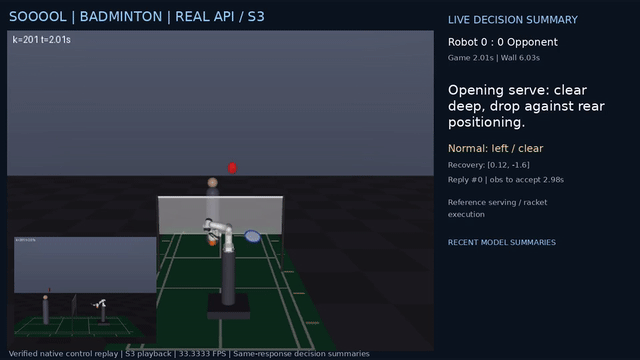
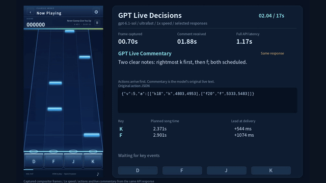
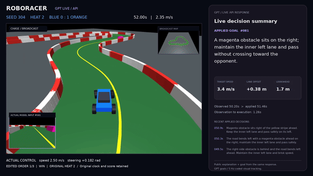

<h1 align="center">Sooool!</h1>

<p align="center"><strong>Can GPT-6 Sol (a coding agent) play real-time games, where the world keeps moving while it thinks?</strong></p>

<p align="center">
<a href="#autoresearch-for-latency-aware-agents">Autoresearch for latency-aware agents</a> · <a href="#how-a-game-runs">How a game runs</a> · <a href="#latency-simulator">Latency simulator</a> · <a href="#games-and-controls">Games &amp; results</a> · <a href="#quick-start">Quick start</a> · <a href="#code-guide">Code guide</a> · <a href="#citation">Citation</a>
</p>

Sooool! uses an autoresearch loop to get GPT-6 Sol to play real-time games, with Agent as Policy. It sees the current game screen, decides what to do, and sends an action. Then it sees what happened and decides again. The challenge is that the game keeps moving while it thinks.

<table>
<tr>
<td width="50%" align="center"><a href="assets/gameplay/touhou.mp4"></a><br><b>Touhou</b> · Real-time API · 1×</td>
<td width="50%" align="center"><a href="assets/tabletennis/seed11-full.mp4"></a><br><b>PingPong</b> · Real-time API · 1×</td>
</tr>
<tr>
<td width="50%" align="center"><a href="assets/gameplay/asterix.mp4"></a><br><b>Asterix</b> · Simulation replay · 5× slowdown</td>
<td width="50%" align="center"><a href="assets/gameplay/badminton.mp4"></a><br><b>Badminton</b> · Real-time API replay · 3× slowdown</td>
</tr>
<tr>
<td width="50%" align="center"><a href="assets/gameplay/rhythm.mp4"></a><br><b>Rhythm</b> · Real-time API · 1×</td>
<td width="50%" align="center"><a href="assets/gameplay/racing.mp4"></a><br><b>Racing</b> · Real-time API · 1×</td>
</tr>
</table>

## Autoresearch for latency-aware agents

We give Codex a game, a goal, an experiment budget, and feedback. It tries to improve how the coding agent plays under response delays: anticipating where a bullet will move or whether a target will still be useful when an action arrives.

1. **Find a failure.** Run the game and inspect screenshots, actions, timing, and outcomes.
2. **Propose a change.** Revise the gameplay instructions, memory, or permitted control settings to address a specific problem.
3. **Compare.** Test the candidate against the previous strategy on the same cases and timing conditions.
4. **Keep or reject it.** Check safety as well as score, then test promising candidates through complete games.
5. **Test in real time.** Fix the selected strategy and settings, run with actual response delays, and use the results to guide the next experiment.

**For example,** in Touhou the coding agent often chased where the boss had been before it started thinking. Codex tested instructions that anticipated the boss's next position. Some changes increased damage but caused more hits, so they were rejected. Adding safety checks for the action's start, movement path, and stopped position produced a candidate that passed comparisons on 12 fixed cases, then went on to full-game simulation and real-time testing. [Full case study](docs/touhou-research-record.md).

A **policy** is the gameplay instructions, fixed notes supplied with each request (called memory), output format, and request settings. Codex improves the prompts and settings without changing the model's weights. Autoresearch took place in Codex Goal mode with human guidance; `sol simulate` runs one game experiment, while Codex handles the analysis and edits across experiments. [Research stories for each game](docs/autoresearch-summaries.md).

## How a game runs

Take Touhou as an example:

1. **Capture.** The runner collects up to three recent screenshots with their frame numbers. Comparing the images helps the agent judge which way the boss and bullets are moving.
2. **Ask.** Send those images with the game instructions, controls already in effect, historical delay information, and the agent's own earlier position estimates. The agent does not receive hidden game coordinates or the delay drawn for this request.
3. **Answer.** The coding agent returns JSON containing its visual estimates and an action plan.
4. **Execute.** The runner checks the format, waits until the answer is allowed to take effect, and applies the chosen buttons. The position estimates do not become automatic dodge or tracking commands.

### Concurrent requests

An answer can take seconds. Sending requests while earlier ones are still waiting can keep decisions coming more often, or provide several chances to get an answer sooner. The selected configurations use three patterns:

| Game | Requests | How answers are used |
|---|---|---|
| **Touhou** | Send the same observation to **four requests at once**. Start another group after a winner takes effect, movement finishes, and enough slots are free. | Use the first valid answer; the other answers for that observation cannot replace it. |
| **Asterix** | **One request at a time.** Observe again after the previous reply. | Hold the chosen direction until a new answer replaces it. |
| **Rhythm** | Try a new screenshot **every 0.2 seconds**, with **up to 16 requests waiting**. Skip sending when full. | Execute the model's tap times, skip expired taps, and prevent duplicate presses using action IDs. |

More requests also mean more calls, cost, and potentially outdated answers. Asterix's serial setup followed limited trials in which overlapping requests appeared to encourage repeated movement. [Request ordering, capacity, and experiment details](docs/latency-aware-learning.md).

A **recipe** is a JSON file selecting a policy, latency profile, and run settings. See the selected recipes: [Touhou simulation](recipes/touhou.json), [Touhou real-time](recipes/touhou-realtime.json), [Rhythm](recipes/rhythm.json), and [Asterix](recipes/asterix.json).

### Action example

One action in the plan might be:

```json
{"move": 3, "shoot": 1, "focus": 1, "bomb": 0, "duration": 12}
```

This means: move right, keep shooting, use slow focused movement, do not use a bomb, and hold for 12 game frames (0.2 seconds at 60 FPS).

In Touhou, movement stops when the plan ends; shooting and focus keep their last settings. A newer accepted decision replaces the unfinished plan. Older observations cannot override a decision already accepted from a newer one.

## Latency simulator

Development uses subscription calls to try strategies under delays measured from the target API. For Touhou and Rhythm, the commands divide the work like this:

| Command | What happens | What it uses |
|---|---|---|
| `sol profile` | Send saved inputs one at a time and measure response times. No game actions are executed. | Paid API calls with a budget cap |
| `sol simulate` | Play a new game and use sampled delays to schedule answers. Virtual time can wait for the model. | ChatGPT subscription calls and a latency profile |
| `sol eval` | Play with a continuously running clock and actual response times. | Paid API calls with a budget cap |

A **latency profile** stores measured response times, including slow replies. The simulator draws from it to decide when each new answer becomes available.

Suppose a screenshot is taken at frame 100 and the drawn delay is half a second. At 60 FPS, the answer can be used at frame 130. Until then, the game advances with the controls already in effect. If the agent finishes early, its answer waits; if it is still computing at frame 130, virtual time waits for it. The agent never sees the drawn delay.

In real-time evaluation, a three-second response means the game also moves forward for three seconds. Asterix uses subscription response times for this test and keeps its declared slowdown; other games have separate [setup guides](docs/release-guide.md).

The simulator also accounts for concurrent requests: Touhou samples groups of delays together, while Rhythm includes screenshot age. Changing prompts, images, or concurrency may require a new profile. Simulated scores do not establish real-time success. [Timing and calibration details](docs/timing.md).

**Replay** can restore a fixed starting state before candidates make new decisions, or reproduce an entire saved action sequence to check timing and make videos. The latter makes no new decisions and is not a new performance result. [Development and replay workflow](docs/development.md).

## Games and controls

The coding agent chooses button presses in screen-based games and tactical goals in robot games. Each game defines what it sees, what it returns, and how the code carries out its decisions.

| Game | Agent input | Agent action | Code execution |
|---|---|---|---|
| [Touhou / Kaguya](docs/touhou-research-record.md) | Up to three recent screenshots, frame times, and prior controls | Movement, shooting, focus, bombs, and duration | Apply the chosen buttons for the specified duration |
| [PingPong](docs/tabletennis.md) | Two camera views, public feedback, and a camera-based opponent estimate | Choose one of four return-placement plans | Track the ball, serve, plan contact, and execute joint motion |
| [Asterix](docs/asterix-autoresearch.md) | Three timestamped screenshots and applied-action history | Joystick direction | Hold the chosen direction until a newer reply replaces it |
| [Badminton](docs/badminton.md) | Four recent frames from two cameras and public feedback | Conditional shot goals, recovery position, and goal duration | Select the applicable goal, plan a reachable contact and swing, and execute the stroke |
| [Rhythm](docs/rhythm.md) | Game screenshot, public clock, and pending taps | DFJK keys and absolute tap times | Queue and execute the specified taps |
| [Racing](docs/racing.md) | Recent front-camera views, telemetry, and camera-derived road measurements | Speed, lane offset, and lookahead | Steer toward the goal and limit speed through bends |

Evaluators may inspect game state to score outcomes. [Observation boundaries](docs/observation-contract.md).

| Game | Result | Execution |
|---|---|---|
| **Touhou** | Boss defeated in 58.47 game seconds, two hits | Real-time API, 1× |
| **PingPong** | Won 5:1 on seed 11; lost 3:5 on seed 12 | Real-time API, 1× |
| **Asterix** | 500 points, two lives after 20 game seconds | Sampled-delay simulation, 5× slowdown |
| **Badminton** | Lost 8:11 | Real-time API, 3× slowdown |
| **Rhythm** | 24 Perfect, 1 Great, zero Miss, two empty presses | Real-time API, 1× music |
| **Racing** | Won 2:0 on seed 304 | Real-time API, 1×, coded steering |

The portable launcher has not reproduced the original Touhou and Rhythm results: its fresh Touhou simulation lost, full paid Touhou evaluation is pending, and its live Rhythm run failed. A fresh Asterix simulation scored 300. [Full results and comparisons](docs/results.md) · [Validation history](docs/validation.md).

<details>
<summary>Game sources and inspirations</summary>

- **Racing, PingPong, and Badminton:** [Embodied Olympics Exam](https://olympics.embodied-first-exam.ai/), using the pinned [RoboOlympics source](https://github.com/CHIGUI0/roboolympics/tree/da1f787f775ea6524d698c0b063157ded4c0fef9).
- **Asterix:** the Atari 2600 game through [ALE](https://ale.farama.org/environments/asterix/), using `ALE/Asterix-v5`.
- **Rhythm:** a custom four-lane browser game inspired by Tencent's [Rhythm Master / 节奏大师](https://apps.apple.com/cn/app/%E8%8A%82%E5%A5%8F%E5%A4%A7%E5%B8%88/id493901993).
- **Touhou:** a simplified Kaguya practice encounter based on [Touhou Eiyashou ~ Imperishable Night](https://www16.big.or.jp/~zun/html/th08top.html), with original-game presentation assets.

</details>

## Quick start

```bash
uv sync --locked --python 3.12
uv run playwright install --with-deps chromium
codex login

uv run sol doctor --game touhou --auth
uv run sol simulate touhou --output runs/touhou-dev-001
```

This uses subscription calls for decisions and historical API measurements for delays. It does not fall back to paid API calls.

To test Touhou in real time, provide an API key through `OPENAI_API_KEY` or the hidden prompt, and set a spending limit:

```bash
uv run sol eval touhou \
  --seed 1 \
  --budget-usd 5 \
  --max-calls 100 \
  --output runs/touhou-api-001
```

Runs save their configuration and source snapshot, model inputs and outputs, applied actions, timing, and results. The Touhou real-time runner also records video and API costs. [Real-time setup and budgets](docs/realtime.md).

Game setup: [Touhou](docs/realtime.md) · [PingPong](docs/tabletennis.md) · [Asterix](docs/release-guide.md) · [Badminton](docs/badminton.md) · [Rhythm](docs/rhythm.md) · [Racing](docs/racing.md)

More commands: [Release guide](docs/release-guide.md) · Comparing strategies: [Development guide](docs/development.md)

## Code guide

| Path | Start here to understand... |
|---|---|
| [`runtime/cli.py`](runtime/cli.py) | How `simulate`, `profile`, and `eval` launch a run |
| [`runtime/subscription.py`](runtime/subscription.py) | How screenshots and instructions are sent through the Codex CLI |
| [`environments/`](environments/) | Game engines, observation interfaces, and action execution |
| [`policies/`](policies/) | The gameplay instructions and expected response formats |
| [`recipes/`](recipes/) | Which strategy and settings an experiment uses |
| [`profiles/`](profiles/) | The measured delays used by the simulator |
| [`research/`](research/) | Hypotheses, comparisons, and research history |
| [`artifacts/`](artifacts/), [`assets/`](assets/) | Run records, replay evidence, videos, and demo clips |

[Detailed file map](docs/file-map.md) · [Evaluation records](docs/evaluation-records.md) · [Optional evidence downloads](artifacts/README.md)

## Citation

```bibtex
@misc{wang2026sooool,
  title        = {Sooool!},
  author       = {Wang, Zihan and Li, Xinyuan and Li, Zeju and Lin, Yuxiang and Gui, Chi and Pei, Jiaxin and Li, Manling},
  year         = {2026},
  url          = {https://github.com/sooool-project/sooool}
}
```
