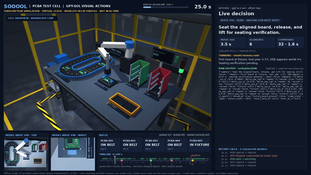
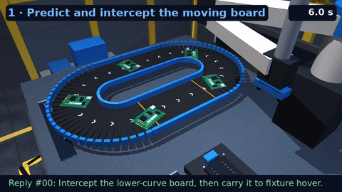
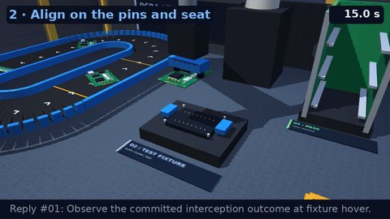
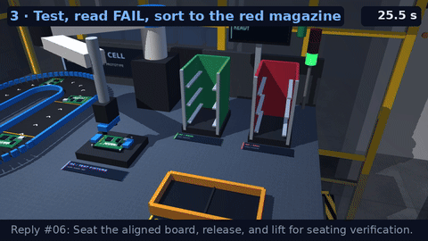
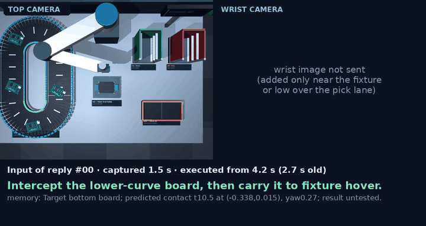
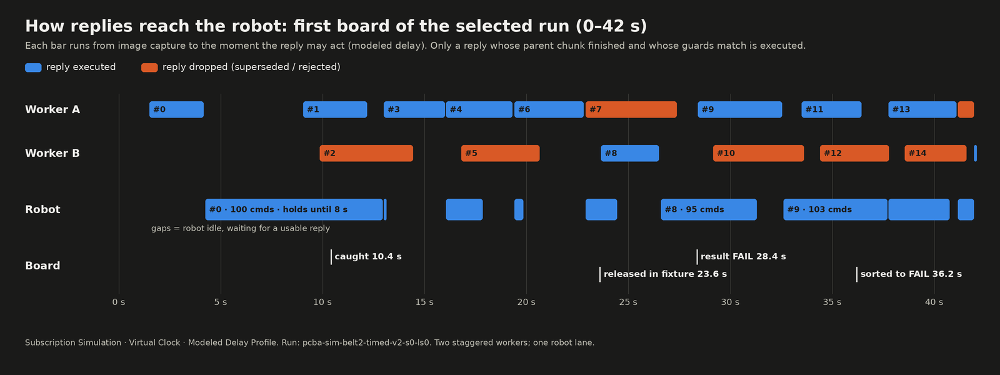

<h1 align="center">Sooool! Agent as Real-Time Policies</h1>

<p align="center"><strong>&#xA0;GPT Sol doing real-time tasks. World keeps moving while it thinks.</strong></p>

<p align="center">
<a href="#latency-profiling-and-simulation">Latency profiling and simulation</a> · <a href="#autoresearch-for-latency-aware-agents">Autoresearch for latency-aware agents</a> · <a href="#how-a-game-runs">How a game runs</a> · <a href="#games-and-controls">Games &amp; controls</a> · <a href="#pcba-test-cell-belt-to-magazine">PCBA test cell</a> · <a href="https://github.com/sooool-project/sooool/blob/main/docs/results.md">Results</a> · <a href="#quick-start">Quick start</a> · <a href="#code-guide">Code guide</a> · <a href="#citation">Citation</a>
</p>

Sooool! uses an autoresearch loop to get GPT-6 Sol to play real-time games, with Agent as Policy. It sees the current game screen, decides what to do, and sends an action. Then it sees what happened and decides again. The challenge is that the game keeps moving while it thinks.

<table>
<tr>
<td width="50%" align="center"><a href="assets/gameplay/touhou.mp4"></a><br><b>Touhou</b> · Live API run</td>
<td width="50%" align="center"><a href="assets/tabletennis/seed11-full.mp4"></a><br><b>PingPong</b> · Live API run</td>
</tr>
<tr>
<td width="50%" align="center"><a href="assets/gameplay/rhythm.mp4"></a><br><b>Rhythm</b> · Live API run</td>
<td width="50%" align="center"><a href="assets/gameplay/racing.mp4"></a><br><b>Racing</b> · Live API run</td>
</tr>
<tr>
<td width="50%" align="center"><a href="assets/asterix/v28-api-60s.mp4"></a><br><b>Asterix</b> · Live API run</td>
<td width="50%" align="center"><a href="assets/gameplay/badminton.mp4"></a><br><b>Badminton</b> · Live API run</td>
</tr>
<tr>
<td colspan="2" align="center"><a href="assets/pcba/timed-v2-s0-ls0-showcase.mp4"></a><br><b>PCBA test cell</b> · Subscription simulation (virtual clock) · <a href="#pcba-test-cell-belt-to-magazine">task flow and metrics</a></td>
</tr>
</table>

## Latency profiling and simulation

Our workflow is **profile → simulate → eval**: measure target API latency, develop strategies with subscription calls on a reproducible virtual clock, then test selected strategies in a live API/subscription run.

### Profile the latency

Send representative screenshots and prompts to the target API and record when a valid action is ready and when the response finishes. These can be different: an action may be usable while the request is still finishing and occupying a slot. Keep the individual timings, including slow replies, in a **latency profile**.

Start with requests sent one at a time. Concurrent runs provide additional measurements of how requests finish together and how long they keep their slots. Touhou's selected profile uses groups of four readiness and completion times; Rhythm also includes screenshot age and transport overhead. Some profiles combine measurements from earlier workloads with modeled timing. Changing the prompt, image setup, or concurrency may require new measurements. [Profiles and measurement sources](profiles/README.md) · [Timing details](docs/timing.md).

We computed the latency profiles below; timings may vary across API setups, and simulated mode lets you reproduce our timing setup.

| Game / selected profile | Samples | Timing endpoint | Mean (ms) | Std (ms) |
|---|---:|---|---:|---:|
| [Touhou (modeled)](profiles/touhou/profile-control-tracking-safe-intercept-v2-transport-v1.json) | 19 groups of four requests | First action ready + apply overhead | 2638.9 | 372.6 |
| [PingPong (proxy)](research/updates/2026-10-16/ubuntu/pingpong/results/profile-stream-serial-v1/profile.json) | 12 serial calls | Action ready | 1326.8 | 552.9 |
| [Asterix](profiles/asterix/latency_v16_actual_5x_512cap.json) | 536 valid calls | Capture to completion | 1665.4 | 1373.2 |
| [Badminton](profiles/badminton/conditional-api-10.json) | 10 serial calls | Action ready | 2070.7 | 323.8 |
| [Rhythm](profiles/rhythm/selected-native-joint.json) | 85 timing samples | Action ready | 1432.7 | 282.2 |
| [Racing (proxy)](profiles/racing/profile.json) | 32 serial calls | Response complete | 1472.1 | 378.6 |
| [PCBA (modeled)](profiles/pcba/ultrafast-modeled-v1.json) | 155 modeled replies | Capture to reply | 3871.9 | 831.3 |

### Build the simulator

During development, subscription calls produce new decisions while the simulator draws delays from the profile. Suppose a screenshot is taken at frame 100 and the drawn delay is half a second. At 60 FPS, the answer can be used at frame 130. Until then, the game advances with the controls already in effect. If the agent finishes early, its answer waits; if it is still computing at frame 130, virtual time waits for it. The agent never sees the drawn delay.

This lets Codex compare strategies under the same delay conditions, even when the actual subscription calls take different amounts of time.

### Live API/subscription run

Fix the selected strategy and run it with actual response times. The game keeps running while the agent responds: a three-second response means the game also moves forward for three seconds.

These commands cover Touhou, Rhythm, and Asterix; `sol profile` is available for Touhou and Rhythm:

| Command | What happens | What it uses |
|---|---|---|
| `sol profile` | Send saved inputs one at a time and measure response times. No game actions are executed. | Paid API calls with a budget cap |
| `sol simulate` | **Simulation:** use sampled delays to schedule new decisions; virtual time can wait for the agent. | ChatGPT subscription calls and a latency profile |
| `sol eval` | **Live API/subscription run:** the game keeps running while the agent responds. | API or subscription calls; paid API calls require a budget cap. |

**Replay** can restore a fixed starting state before candidates make new decisions, or reproduce a saved action sequence to check timing and make videos. Replaying saved actions makes no new decisions and is not a new performance result. [Development and replay workflow](docs/development.md).

## Autoresearch for latency-aware agents

With the simulator, Codex can try changes, compare strategies, and inspect failures before testing in real time. We give it a game, a goal, an experiment budget, and feedback. It improves how the coding agent plays under response delays: anticipating where a bullet will move or whether a target will still be useful when an action arrives.

1. **Find a failure.** Run the game and inspect screenshots, actions, timing, and outcomes.
2. **Propose a change.** Revise the gameplay instructions, memory, or permitted control settings to address a specific problem.
3. **Compare.** Test the candidate against the previous strategy on the same cases and timing conditions.
4. **Keep or reject it.** Check safety as well as score, then test promising candidates through complete games.
5. **Test in real time.** Fix the selected strategy and settings, run with actual response delays, and use the results to guide the next experiment.

**For example,** in Touhou the coding agent often chased where the boss had been before it started thinking. Codex tested instructions that anticipated the boss's next position. Some changes increased damage but caused more hits, so they were rejected. Adding safety checks for the action's start, movement path, and stopped position produced a candidate that passed comparisons on 12 fixed cases, then went on to full-game simulation and a live API/subscription run. [Full case study](docs/touhou-research-record.md).

A **policy** is the gameplay instructions, fixed notes supplied with each request (called memory), output format, and request settings. Codex improves the prompts and settings without changing the model's weights.

Autoresearch took place in Codex Goal mode with human guidance; `sol simulate` runs one game experiment, while Codex handles the analysis and edits across experiments. [Research stories for each game](docs/autoresearch-summaries.md).

## How a game runs

Take Touhou as an example:

1. **Capture.** The runner collects up to three recent screenshots with their frame numbers. Comparing the images helps the agent judge which way the boss and bullets are moving.
2. **Ask.** Send those images with the game instructions, controls already in effect, historical delay information, and the agent's own earlier position estimates. The agent does not receive hidden game coordinates or the delay drawn for this request.
3. **Answer.** The coding agent returns JSON containing its visual estimates and an action plan.
4. **Execute.** The runner checks the format, waits until the answer is allowed to take effect, and applies the chosen buttons. The position estimates do not become automatic dodge or tracking commands.

### Concurrent requests

An answer can take seconds. Sending requests while earlier ones are still waiting can keep decisions coming more often, or provide several chances to get an answer sooner. The games use three request patterns:

| Game | Requests | How answers are used |
|---|---|---|
| **Touhou** | **Four requests per observation**; next group after the selected move finishes and slots are available. | Use the first valid answer; the other answers for that observation cannot replace it. |
| **Asterix** | **One request at a time.** Observe again after the previous reply. | Hold the chosen direction until a new answer replaces it. |
| **Rhythm** | Try a new screenshot **every 0.2 seconds**, with **up to 16 requests waiting**. Skip sending when full. | Execute the model's tap times, skip expired taps, and prevent duplicate presses using action IDs. |
| **PCBA** | **Two staggered requests**: capture about one measured reply latency before the committed chunk ends; hold while a committed test result is still pending. | Run a reply only after its parent chunk ends and its declared start pose and sensor guards match; the newest valid reply wins, superseded ones are dropped. |

More requests also mean more calls, cost, and potentially outdated answers. Asterix's serial setup followed limited trials in which overlapping requests appeared to encourage repeated movement. [Request ordering, capacity, and experiment details](docs/latency-aware-learning.md).

A **recipe** is a JSON file selecting a policy, latency profile, and run settings. See the selected recipes: [Touhou simulation](recipes/touhou.json), [Touhou live run](recipes/touhou-realtime.json), [Rhythm](recipes/rhythm.json), and [Asterix](recipes/asterix.json).

### Action example

One action in the plan might be:

```json
{"move": 3, "shoot": 1, "focus": 1, "bomb": 0, "duration": 12}
```

This means: move right, keep shooting, use slow focused movement, do not use a bomb, and hold for 12 game frames (0.2 seconds at 60 FPS).

In Touhou, movement stops when the plan ends; shooting and focus keep their last settings. A newer accepted decision replaces the unfinished plan. Older observations cannot override a decision already accepted from a newer one.

## Games and controls

The coding agent chooses button presses in screen-based games and tactical goals in robot games.

| Game | Agent input | Agent action | Code execution |
|---|---|---|---|
| [Touhou / Kaguya](docs/touhou-research-record.md) | Recent screenshots, frame times, prior controls | Direction, shooting, focus, bombs, duration | Apply chosen buttons for the specified duration |
| [PingPong](docs/tabletennis.md) | Two camera views, feedback, opponent estimate | One of four return-placement plans | Track the ball, serve, plan contact, execute joint motion |
| [Asterix](docs/asterix-autoresearch.md) | Three timestamped screenshots, action history | Joystick direction | Hold direction until replaced |
| [Badminton](docs/badminton.md) | Recent frames from two cameras, public feedback | Conditional shot goals, recovery position, goal duration | Plan contact and swing; execute stroke |
| [Rhythm](docs/rhythm.md) | Screenshot, public clock, pending taps | DFJK keys, absolute tap times | Queue and execute specified taps |
| [Racing](docs/racing.md) | Front-camera views, telemetry, visual road measurements | Speed, lane offset, lookahead | Steer toward goal, limit speed through bends |
| [PCBA test cell](#pcba-test-cell-belt-to-magazine) | Overhead camera (+ wrist camera near fixture/lane), robot pose and force, vacuum/fixture/slot switches, public calibration, own memory | Literal XYZ/yaw step segments with repeat counts (50 ms each), vacuum and fixture requests, start guards, optional start time | Validate limits and guards, inverse kinematics, execute each step; no grasp, tracking or placement controller |

Evaluators may inspect game state to score outcomes. [Observation boundaries](docs/observation-contract.md).

## PCBA test cell: belt to magazine

The PCBA cell is the first robot workcell in this repository built from scratch for agent-as-policy control. GPT-6.1 Sol watches a MuJoCo electronics test cell and writes **every literal robot command**: each 50 ms Cartesian step, every wait, every vacuum and fixture request. There is no grasp macro, tracker or place controller between the model and the robot. The belt never stops while the model thinks, so a decision that is right but late misses the board.

**Status.** Development is in subscription simulation on a virtual clock (fresh model decisions; modeled delays averaging 3.87 s, about 40% faster than measured Fast; not a live or 1× result). The best run picked all 5 boards, tested 4 and sorted 4 correctly with no wrong sorts, 3 of them before the 150 s deadline. No run has yet sorted all five boards on time. Live subscription runs exist for the earlier stopped-line cell (5 tested, 4 sorted in 600 s) and for loop latency tuning (no board sorted). All numbers below are single runs or three-run cohorts, not success-rate estimates. [Setup and evidence boundaries](docs/pcba.md) · [Loop challenge](docs/pcba-loop.md) · [Latency, concurrency and research log](docs/pcba-concurrency.md) · [Research summary](docs/pcba-research.md) · [All simulation runs](artifacts/pcba/simulations.json)

<p align="center"><a href="assets/pcba/timed-v2-s0-ls0-showcase.mp4"></a><br><b>PCBA</b> · Subscription simulation, virtual clock, modeled ultrafast delays · <a href="assets/pcba/timed-v2-s0-ls0-showcase.mp4">full 180 s run</a></p>

### The cell

| Part | Setting |
|---|---|
| Boards | 5 free-body PCBAs (`PCBA-001`…`005`), seeded lateral offset up to ±21 mm and yaw up to ±0.60 rad; turns can add skew |
| Input belt | Racetrack loop, 1.851 m, 0.055 m/s, 33.65 s per lap, counter-clockwise; it never pauses for inference |
| Pick window | Marked right straight, 0.28 m long, about 5.1 s of board travel |
| Robot | SCARA arm with Z slide and tool yaw, ideal proximity vacuum latch, commands every 50 ms; each command ≤ 0.025 m translation and ≤ 0.2 rad yaw; ≤ 120 commands (6 s) per reply |
| Test fixture | Seat within 4 mm and 0.10 rad on the locator pins, clamp, run a mock electrical test; PASS / FAIL / ERROR is published only when the test ends |
| Outputs | Green PASS magazine (3 slots), red FAIL magazine (3 slots), amber ERROR tray (2 places); a board counts only when fully inserted, released, upright, on both rails |
| Deadline | 150 simulation seconds for the batch and at most four unpicked laps per board; an expired board stays expired even if sorted later |
| Physics | MuJoCo 3.3.7 on CPU, 100 Hz, independent of model replies |

### One board, step by step

<table>
<tr>
<td width="33%" align="center"></td>
<td width="33%" align="center"></td>
<td width="33%" align="center"></td>
</tr>
<tr>
<td align="center"><b>1 · Predict and intercept</b><br>Reply #00 sets <code>start_at_s: 8</code>, parks the cup on the belt and catches the moving board at 10.4 s.</td>
<td align="center"><b>2 · Align and seat</b><br>Wrist-camera check at the fixture hover, yaw correction, then seat and release at 23.6 s.</td>
<td align="center"><b>3 · Test and sort</b><br>Clamp, mock test publishes FAIL at 28.4 s, regrasp, insert into the red magazine at 36.2 s.</td>
</tr>
</table>

Close-ups of the first board in the selected run, rendered from its recorded states; the bottom line is the summary of the reply executing at that moment.

| Step | What the model decides | What the code does |
|---|---|---|
| 1. Locate | Reads board positions and USB orientation from the overhead image, using the public pixel-to-world calibration and the image timestamp | Captures the image; never sends board poses |
| 2. Predict | Picks a contact time and place on the right straight from belt speed, image age and its own queued motion; may set `start_at_s` | Forwards `start_at_s` unchanged; refuses a reply that arrives after its own start time |
| 3. Intercept | Moves above the predicted point, lowers to about 2 mm above the board surface, turns the vacuum on and waits for the board to arrive | Executes each delta through inverse kinematics; the ideal vacuum latches only when the cup is close enough to a board |
| 4. Carry and align | Lifts, carries to the fixture hover, measures the grasp offset in the wrist image and corrects position and yaw | Adds the wrist image only from public signals (vacuum on, tool near fixture or low over the lane) |
| 5. Seat and test | Lowers onto the pins, holds until the arm settles, releases, closes the clamp, starts the test | Fixture switches report presence and clamp state; the result stays hidden until published |
| 6. Read the result | Waits for the published PASS / FAIL / ERROR; never guesses | The scheduler holds new captures while a committed test result is still pending |
| 7. Unload and sort | Opens the clamp, regrasps, keeps the tool yaw, inserts into a vacant matching slot, holds, releases | Slot presence switches are public; correctness is scored by the evaluator only |
| 8. Next board | Plans the next interception while finishing the sort | — |

Timeline of the selected run (`runs/pcba-sim-belt2-timed-v2-s0-ls0`, simulation seconds):

| Board | Caught | Seated in fixture | Published result | Sorted | Outcome |
|---|---:|---:|---|---:|---|
| PCBA-005 | 10.4 | 23.6 | FAIL at 28.4 | 36.2 | Correct, on time |
| PCBA-004 | 49.1 | 67.9 | PASS at 70.5 | 84.4 | Correct, on time |
| PCBA-003 | 90.2 | 106.2 | FAIL at 108.5 | 118.8 | Correct, on time |
| PCBA-002 | 130.3 | 142.7 | ERROR at 145.3 | 153.6 | Correct tray, after its 151.0 s lap deadline |
| PCBA-001 | 171.4 | — | — | — | Fourth unpicked lap at 135.7 s; still held at 180 s |

Each board took about 35–40 s from catch to sort: 17–24 s of robot motion plus two or three short check replies at the fixture hover and a wait for the published result.

### What the model sees and returns

Each request carries the overhead image (640×480, plus the wrist image near the fixture or pick lane), the image timestamp, measured joint and tool pose, tool force, vacuum, fixture and output-slot switches, the fixed workcell calibration, the reply-latency percentiles of earlier calls, its own previous memory note and receipt, and the literal segments and expected end pose of the chunk already committed. It never receives board poses, velocities, lap counters, test results before publication, or the delay drawn for this request.

<p align="center"><br><sub>The exact images sent with each executed reply during the first board (top camera always; wrist camera only near the fixture or low over the lane), with the reply's summary and memory note.</sub></p>

The first reply of the selected run (verbatim values, one segment per line):

```json
{
  "summary": "Intercept the lower-curve board, then carry it to fixture hover.",
  "memory": "Target bottom board; predicted contact t10.5 at (-0.338,0.015), yaw0.27; result untested.",
  "done": false,
  "segments": [
    {"delta_xyz_m": [-0.0199, -0.0022, 0], "delta_yaw_rad": 0.0169, "repeat": 16, "vacuum": null, "fixture": null},
    {"delta_xyz_m": [0, 0, -0.0201], "delta_yaw_rad": 0, "repeat": 11, "vacuum": null, "fixture": null},
    {"delta_xyz_m": [0, 0, 0], "delta_yaw_rad": 0, "repeat": 8, "vacuum": null, "fixture": null},
    {"delta_xyz_m": [0, 0, 0], "delta_yaw_rad": 0, "repeat": 27, "vacuum": true, "fixture": null},
    {"delta_xyz_m": [0, 0, 0.02], "delta_yaw_rad": 0, "repeat": 5, "vacuum": true, "fixture": null},
    {"delta_xyz_m": [0.0212, -0.0059, 0], "delta_yaw_rad": -0.018, "repeat": 15, "vacuum": true, "fixture": null},
    {"delta_xyz_m": [0, 0, -0.0103], "delta_yaw_rad": 0, "repeat": 10, "vacuum": true, "fixture": null},
    {"delta_xyz_m": [0, 0, 0], "delta_yaw_rad": 0, "repeat": 8, "vacuum": true, "fixture": null}
  ],
  "start_guard": {"vacuum_ok": false, "fixture_board_present": false, "clamp_state": "open", "tester_state": "idle", "result_test_id": null},
  "start_at_s": 8
}
```

Read it as: wait until t = 8.0 s; move 0.32 m toward the belt in 0.8 s while turning to the board's yaw; descend 0.22 m; settle; switch the vacuum on and wait 1.35 s for the board to arrive; lift; carry back toward the fixture and lower to hover. The model predicted contact at 10.5 s; the vacuum latched at 10.41 s. Each `repeat` applies its delta once every 50 ms. `memory` is the model's own note for the next request; `start_guard` states the public sensor values the model expects when the chunk starts.

Before a reply runs, the executor checks the schema, every step limit, the 120-command horizon, the 12 s observation lifetime, the expected start pose and the declared sensor guards. It never clips a value or fixes a plan; any violation rejects the whole reply.

### Request pipeline

Two model workers run concurrently. The **stagger** scheduler captures a new image about one reply latency before the committed chunk ends, estimated from the last 12 reply latencies: the first outstanding request uses their p80 (4.37 s on average in the selected run, range 3.58–4.91 s), the second their p40 (3.45 s, range 3.07–4.15 s); 4.0 s is used until three replies exist. In practice requests were issued only 2.3 s (median 2.4 s) before their parent chunk ended: many chunks last just 1–3 s, a request can only plan from a chunk that has already started, and captures pause while a test result is pending. That is why the robot still waits 1.86 s on average between chunks. A reply is admitted only after its parent chunk ends, and the newest valid reply wins. What happened to the 66 requests of the selected run:

| Result | Requests | Meaning |
|---|---:|---|
| Executed as a chunk | 36 | Parent finished, guards matched, within lifetime |
| Superseded | 22 | A newer reply for the same robot state was selected first |
| Parent failed | 2 | The chunk it was planned on did not finish as expected |
| Request error | 2 | Transport error; no action |
| In flight at stop | 2 | Still computing when the 180 s run ended |
| Invalid output | 1 | Failed schema or step limits |
| Start guard mismatch | 1 | Public sensors disagreed with the model's declared start state |

<p align="center"></p>

### How the policy got here

Research followed the profile → simulate → eval loop. Live subscription runs set the latency budget; then each protocol change was compared in three subscription simulations (env/latency seeds 0/0, 0/1, 1/0; 180 virtual seconds; modeled ultrafast delays). Every attempted run is kept.

**Live subscription runs (real clock):**

| Run | Condition | Requests / chunks | Mean request latency | Picked / tested / sorted | Note |
|---|---|---|---:|---|---|
| `pcba-policy-fast-v1` | Stopped line, Fast tier, serial | 69 / — | 5.66 s median | 5 / 5 / 4 in 600 s | Easy baseline: line and fixture wait for the model |
| `pcba-loop-latency-tuned-c2-v1` | Loop, lean output, 480×360, stagger c2 | 22 / 9 | 9.10 s | 1 / 0 / 0 | Robot moving 2.9% of the time; timing gate failed |
| `pcba-loop-latency-tuned-c2-v2` | Loop, ≤0.022 m step margin + top-camera calibration | 32 / 17 | 6.81 s (median 6.03 s) | 2 / 0 / 0 | Reasoning tokens 229 → 103, motion 6.7%; placement became the limit |

**Subscription simulations on the revised belt** (picked, tested and correct sorts per run, in seed order 0/0, 0/1, 1/0):

| Stage | Protocol change | Picked | Tested | Correct sorts | Sorted by 150 s | Robot motion |
|---|---|---|---|---|---|---:|
| lean3 placement | Measure grasp, hover, correct on pins, release in its own command | 1 / 2 | 1 / 2 | 0 / 2 | 0 / 2 | 27–32% |
| lean4 interception v1 | Ambush the board downstream; never chase | 1 / 1 / 1 | 0 / 0 / 0 | 0 / 0 / 0 | 0 / 0 / 0 | 22–25% |
| lean4 v2 | + USB-orientation rule (boards seated at yaw π failed) | 3 / 3 / 3 | 1 / 2 / 3 | 0 / 1 / 2 | 0 / 1 / 1 | 38–45% |
| lean5 cycle v1 | Chain seat/release/clamp/test/open/regrasp in long guarded chunks | 1 / 5 / 5 | 1 / 2 / 4 | 0 / 0 / 0 | 0 / 0 / 0 | 69–75% |
| **lean5 cycle v2** | + hold before every release; keep tool yaw to the slot | 4 / 4 / 5 | 3 / 3 / 4 | **3 / 3 / 4** | 2 / 2 / 3 | 60–69% |
| lean6 | Two replies per board | 3 / 4 / 4 | 3 / 3 / 4 | 2 / 2 / 4 | 1 / 2 / 3 | 58–61% |
| lean6 v2 | Without wait-only chunks | 3 / 4 / 4 | 3 / 4 / 4 | 3 / 2 / 2 | 2 / 2 / 2 | 55–76% |
| lean7 timed v1 | Model-authored `start_at_s` for predictive interception | 3 / 4 / 5 | 1 / 3 / 5 | 1 / 3 / 4 | 1 / 3 / 3 | 45–60% |
| **lean7 timed v2** | + set tool yaw from the USB direction before the catch | **5** / 3 / 5 | **4** / 2 / 4 | **4** / 2 / 3 | 3 / 2 / 2 | 48–68% |

lean3 has two runs (env seed 0, latency seeds 0 and 1). Every run, its discard reasons and report hash: [`artifacts/pcba/simulations.json`](artifacts/pcba/simulations.json).

What each step taught:

- **Latency is mostly reasoning.** Time to the first answer token was 7–12 s on Fast; transport setup was about 6 ms. Prestarting threads saved about 0.5 s; lower image resolution increased reasoning. A 0.022 m step margin removed the replies rejected for landing just above the 0.025 m limit (about a quarter before).
- **Interception beats chasing.** Waiting downstream with the vacuum on moved the first catch from 30–113 s to 19–32 s. Orientation had to be fixed at the catch: boards caught with the USB connector reversed could not be seated.
- **The arm lags its commands.** At full speed the tool trails commanded positions by centimetres; releasing without a hold dropped boards 5–9 mm short. Holding before every release turned lean5 from 0 to 10 correct sorts across three runs.
- **Throughput is the remaining gap.** Even the best run spends about 35 s per board. Timed starts were used in only 6 of 36 chunks; most of the remaining time is short check replies at the fixture. Reaching all five boards by 150 s likely needs longer verified open-loop chunks or an explicitly labelled hybrid control layer.

### Selected run in numbers

| Metric | `pcba-sim-belt2-timed-v2-s0-ls0` |
|---|---:|
| Boards picked / tested / correctly sorted / sorted by 150 s | 5 / 4 / 4 / 3 |
| Wrong sorts, drops | 0, 0 |
| Model requests / replies / executed chunks | 66 / 62 / 36 |
| Literal robot commands executed | 1,942 |
| Chunks with a model-timed `start_at_s` | 6 of 36 |
| Sampled reply delay (profile draw): mean / p50 / p95 | 3.80 / 3.52 / 4.93 s |
| Image age when its chunk started: mean / p95 | 3.68 / 4.70 s |
| Idle wait between chunks: mean / p95 | 1.86 / 4.75 s |
| Robot moving | 54% of the 180 s |
| Output / reasoning tokens per reply (mean) | 514 / 225 |
| Wall time for 180 virtual seconds | 614 s (536 s spent waiting on inference outside virtual time) |

**Simulator delay setting.** Every simulation above draws each request's capture-to-reply delay at random (independently per request; reproducible from the fixed latency seed, so runs with the same seed face the same sequence of draws) from [`profiles/pcba/ultrafast-modeled-v1.json`](profiles/pcba/ultrafast-modeled-v1.json) at capture time (scale 1.0, never shown to the model; if inference takes longer, the virtual clock waits):

| Profile | Samples | Mean | p50 | p95 | Std | Min / max |
|---|---:|---:|---:|---:|---:|---:|
| PCBA ultrafast (modeled) | 155 | 3.87 s | 3.68 s | 5.19 s | 0.83 s | 2.67 / 8.71 s |
| Draws in the selected run | 66 | 3.80 s | 3.52 s | 4.93 s | — | 2.72 / 8.71 s |
| Measured Fast, live loop (`pcba-loop-latency-tuned-c2-v2`) | 32 | 6.81 s | 6.03 s | — | — | — |
| Measured Fast, single-request benchmark | 8 | 5.36 s | 5.34 s | 6.13 s | — | — |

The profile is **modeled, not measured**: a linear fit of historical GPT-6.1 Sol low/Ultrafast paid-API Touhou timings (≈ 1.05 s + 0.084 s per 1k input tokens + 0.0067 s per output token, residual SD 0.45 s), applied to the token counts of each Fast reply in `pcba-loop-latency-tuned-c2-v2`, plus resampled residuals and the measured local capture/encode time. This account offered only the Fast tier, and Codex 0.163 did not confirm Ultrafast. PCBA prompts (~7k input tokens) lie outside the fitted range (≤ 3.1k), and the 15–40 s server tails seen on Fast are not represented. The simulator is therefore about 40% faster than measured Fast; results here are optimistic for today's Fast tier.

### The video

The [full video](assets/pcba/timed-v2-s0-ls0-showcase.mp4) is an offline render of the selected run's recorded MuJoCo states (zero model calls). The left side shows the cell, the exact top and wrist images the model received for the executing reply, each board's state, and a 0–180 s timeline of executed chunks, dropped replies and sorts. The right side shows the executing reply: its summary, its memory note, and its **raw JSON output verbatim**, with the segment being executed highlighted. Hidden reasoning is not logged, so it is not shown.

The factory dressing (floor, walls, fence, storage rack, cabinet, stack light, live tester screen, PCB artwork, moving belt chevrons) is a render-only skin: it adds no joints and no collision geometry, and the model's cameras in the run used the plain research scene. Poses are interpolated from about 10 Hz recorded states to 20 fps. [Provenance](assets/pcba/timed-v2-s0-ls0-showcase.provenance.json).

### Run it

```bash
uv run sol env setup pcba
export SOL_CODEX_BIN=/absolute/path/to/codex   # signed in with ChatGPT; no paid API fallback

# Develop: fresh subscription decisions, modeled delays, virtual clock
uv run sol simulate pcba --profile profiles/pcba/ultrafast-modeled-v1.json --output-mode lean7 \
  --camera-mode adaptive --top-calibration --schedule stagger --concurrency 2 \
  --duration 180 --max-calls 100 --continue-after-deadline --output runs/pcba-sim-new

# Live subscription run on the real clock
uv run sol pipeline pcba --layout loop --physics-process --output-mode lean7 --camera-mode adaptive \
  --top-calibration --schedule stagger --concurrency 2 --transport-tuning --wall-seconds 180 --max-calls 100 \
  --output runs/pcba-live-new

# Showcase video from any retained run (no model calls)
uv run sol showcase pcba --source runs/pcba-sim-new --workers 3
# README explainer figures (step close-ups, model-input GIF, pipeline timeline)
uv run sol figures pcba --source runs/pcba-sim-new --output assets/pcba/steps
```

## Game environments

| Game | Implementation | Source / inspiration |
|---|---|---|
| **Touhou / Kaguya** | Our simplified practice environment | [Touhou: Imperishable Night](https://www16.big.or.jp/~zun/html/th08top.html); original-game presentation assets |
| **PingPong** | Upstream environment; our agent interface and controller adaptations | [Embodied Olympics Exam](https://olympics.embodied-first-exam.ai/) |
| **Asterix** | Atari game through ALE; our agent runner | [Arcade Learning Environment](https://ale.farama.org/environments/asterix/) |
| **Badminton** | Upstream environment; our agent interface and controller | [Embodied Olympics Exam](https://olympics.embodied-first-exam.ai/) |
| **Rhythm** | Our four-lane browser game | Inspired by [Rhythm Master](https://apps.apple.com/cn/app/%E8%8A%82%E5%A5%8F%E5%A4%A7%E5%B8%88/id493901993) |
| **Racing** | Upstream environment; our agent interface and steering controller | [Embodied Olympics Exam](https://olympics.embodied-first-exam.ai/) |
| **PCBA test cell** | Our MuJoCo CPU workcell with procedural scene and showcase assets | Electronics functional-test and sorting cells |

[Full results and comparisons](https://github.com/sooool-project/sooool/blob/main/docs/results.md) · [Validation history](https://github.com/sooool-project/sooool/blob/main/docs/validation.md).

## Quick start

```bash
git submodule update --init -- vendor/latency-aware-agents
uv sync --locked --python 3.12
uv run sol env setup touhou
codex login

uv run sol simulate touhou --output runs/touhou-dev-001
```

For a live API/subscription run of Touhou, provide an API key through `OPENAI_API_KEY` or the hidden prompt, and set a spending limit:

```bash
uv run sol eval touhou \
  --seed 1 \
  --budget-usd 5 \
  --max-calls 100 \
  --output runs/touhou-api-001
```

Game setup: [Touhou](docs/realtime.md) · [PingPong](docs/tabletennis.md) · [Asterix](docs/release-guide.md) · [Badminton](docs/badminton.md) · [Rhythm](docs/rhythm.md) · [Racing](docs/racing.md) · [PCBA](docs/pcba.md)

Prepare each game with `uv run sol env setup <game>`. Registered experiment runners use `sol simulate` or `sol eval`. PvZ and Red Alert currently provide setup only. [Environment management](docs/environments.md).

More commands: [Release guide](docs/release-guide.md) · Comparing strategies: [Development guide](docs/development.md)

## Code guide

| Path | Start here to understand... |
|---|---|
| [`runtime/cli.py`](runtime/cli.py) | How `simulate`, `profile`, and `eval` launch a run |
| [`runtime/subscription.py`](runtime/subscription.py) | How screenshots and instructions are sent through the Codex CLI |
| [`environments/`](environments/) | Game engines, observation interfaces, and action execution |
| [`policies/`](policies/) | The gameplay instructions and expected response formats |
| [`recipes/`](recipes/) | Which strategy and settings an experiment uses |
| [`profiles/`](profiles/) | The measured delays used by the simulator |
| [`research/`](research/) | Hypotheses, comparisons, and research history |
| [`artifacts/`](artifacts/), [`assets/`](assets/) | Run records, replay evidence, videos, and demo clips |

[Detailed file map](docs/file-map.md) · [Evaluation records](docs/evaluation-records.md) · [Optional evidence downloads](artifacts/README.md)

## Citation

```bibtex
@misc{wang2026sooool,
  title        = {{Sooool! Agent as Real-Time Policies}},
  author       = {Wang, Zihan and Li, Xinyuan and Li, Zeju and Lin, Yuxiang and Gui, Chi and Pei, Jiaxin and Li, Manling},
  year         = {2026},
  url          = {https://github.com/sooool-project/sooool}
}
```
