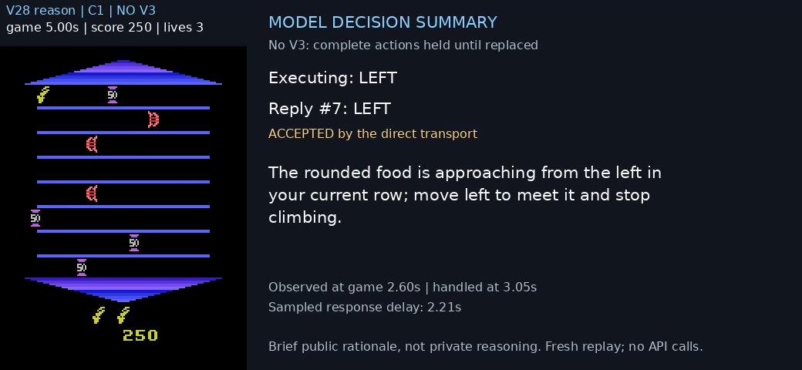

# SOOOOL — visual policy autoresearch

SOL develops visual game policies through a human-guided research loop: inspect failures, propose prompt changes, evaluate frozen candidates, replay the evidence, and keep the configuration that works. Asterix movement comes directly from the model; each game declares its own control semantics. This repository separates **real-time evaluation** from **simulation development** and records how each result was obtained.

The selected Asterix demo uses **V28, one request at a time, direct unchanged actions, and brief public English decision summaries**. Its historical profile simulation completed 20 game seconds with 500 points and two lives on seed 5. This is one development trial, not a general success rate or real-time API result.

[](../assets/asterix/v28-serial-english.mp4)

[Watch/download the replay with original arcade music](../assets/asterix/v28-serial-english.mp4) · [How SOL iterated to this policy](../docs/asterix-autoresearch.md) · [Evaluation record protocol](../docs/evaluation-records.md)

## Run

Linux, Python 3.10–3.12, and a Codex CLI signed in with a ChatGPT subscription supporting the exact model are required. The tested native CLI is 0.162.1. `SOL_CODEX_BIN` selects a standalone executable; `SOL_CODEX_HOME` selects an existing login directory. Credentials are never copied into the repository, and there is no paid API fallback.

```bash
uv sync --locked --python 3.12
codex login
uv run sol doctor --game asterix --auth

# Development: historical delay samples schedule model actions in virtual time.
uv run sol simulate asterix --output runs/asterix-development

# Evaluation: the game clock advances while the model computes.
uv run sol eval asterix --output runs/asterix-realtime

# Explicit comparison without public English summaries.
uv run sol simulate asterix --recipe recipes/asterix-action-only.json

# Append the research decision without overwriting prior assessments.
uv run sol record runs/asterix-development --decision diagnostic \
  --note "Inspect missed pickups; confirm on additional seeds before promotion."
```

Both Asterix modes use 12 raw FPS, a 5× slowdown, and a default 20-game-second horizon. `--seed` and `--duration` select another condition. Simulation pauses the environment when native computation must finish; evaluation uses actual wall time and subscription latency. Subscription latency is not ultrafast API latency. Both send real screenshots/prompts to SOL. `SOL_QUOTA_STOP_PERCENT` defaults to 80; interruptions preserve partial evidence.

## Read the result with its conditions

| Asterix development condition | Action only | Action + English summary |
|---|---|---|
| Eight in-flight requests, direct actions | 400 points; died at 14.67s | 200 points; died at 15.53s |
| One in-flight request, direct actions | 250 points; 20s, one life | **500 points; 20s, two lives** |

These are single seed-5 trials under historical sampled API delays. Serial requests improved observed survival; action-only scoring declined. They motivate the selected recipe, without establishing a causal concurrency effect. The 26-case prompt comparison and these games are different evidence types. [Raw campaign records](../artifacts/asterix/) retain failures, source hashes, applied actions and replay checks.

Fresh portable validation completed 20 game seconds at **300 points/one life**, and a five-game-second actual-clock subscription smoke completed at **50 points/three lives**. These new runs are recorded separately from the historical 500-point demonstration.

Every new run snapshots its code/recipe and emits `evaluation-record.json`; `sol record` appends retain/reject/diagnostic decisions. [Validation](../docs/validation.md) distinguishes historical records, cold replay, fresh portable simulation, and actual-clock trials. [Real-time evaluation](../docs/realtime.md) describes the clocks and remaining API transfer work.

## Racing: SOL develops, then evaluates in real time

[Start with the Racing workflow](../docs/racing.md) and [the evidence-linked iteration record](../research/racing/EVALUATION.md). SOL changes prompts/control representation, tests delayed closed-loop decisions in simulation, inspects failures, freezes a candidate, and transfers it to continuously advancing API gameplay.

The selected **early lane-commit-v14** checkpoint won seed304 **2:0** using real `gpt-6.1-sol / low / ultrafast` API decisions. The English-summary video variant won a separate **2:1** retake. GPT selects speed, stripe-relative offset and lookahead; a coded 5 Hz visual tracker supplies steering and bend speed limiting. These are hybrid Level 1 results, not direct GPT steering. Historical subscription groups used numeric camera features but omitted image contents; that input limitation is preserved in the record.

```bash
# Use the separate Racing environment/dependencies described in docs/racing.md.
python scripts/racing.py simulate --output runs/racing-dev101 --seed 101
# Real-time eval requires process-only credentials and an explicit capped ledger.
python scripts/racing.py eval --output runs/racing-api304 --seed 304 \
  --budget-ledger runs/racing-budget.json --stage-cap-usd 10
```

[Watch/download: seed304, edited win → loss → win](../artifacts/videos/racing-seed304-win-loss-win.mp4). Original heat IDs, clock and score remain visible; actual API explanations and actions stay synchronized. [How to track an evaluation](../research/racing/RECORDS.md) defines hypotheses, full cohorts, replay checks, costs and promotion gates. Later development branches are outside this selected lineage.

## Touhou: realtime API evaluation

The selected Touhou/Kaguya case uses the same research loop. The selected controller is the **early `tracking_dodge_safe_intercept_v2` checkpoint**, with native English public decision summaries. SOL chooses every direction, shot, focus, bomb and duration; the executor only validates and mechanically applies a response. A human supplied the task, budget, behavior feedback and a demonstrated trajectory. No model weights were trained.


**Read the research:** [how v2 was developed and selected](../docs/touhou-research-record.md) · [development workflow](../docs/touhou-development.md) · [evaluation records](../docs/evaluation-records.md).

## Run an actual realtime evaluation

Linux, Python 3.10–3.12 and Chromium-compatible dependencies are required. Install Noto CJK fonts if Japanese/Chinese glyphs are unavailable.

```bash
uv sync --locked --python 3.12
uv run playwright install --with-deps chromium
uv run sol doctor --game touhou

# Reads OPENAI_API_KEY from process memory or prompts without echo.
# New run, explicit $5 ledger cap, at most 100 requests; no inference-time pause.
uv run sol eval touhou --seed 1 --budget-usd 5 --max-calls 100 \
  --output runs/touhou-api-001
```

This is the implemented API path. A fresh full-game paid validation of this new launcher is pending; historical source-harness results are labeled separately. It records complete model inputs/public outputs, applied actions, browser clocks, video, cost and a machine-readable `record.json`. A complete legal summary/action pair can apply before stream termination; all other requests still drain and settle. Only verified boss defeat at 1× is realtime acceptance. Survival, interrupted accounting and replay are distinct outcomes.

Budgets apply to the chosen ledger, including conservative in-flight reservations. A run gets its own ledger by default; `--ledger ...` explicitly selects a shared **cumulative** budget. Credentials are never command arguments or saved in runs. See [realtime details](../docs/realtime.md).

## Develop in the simulator

```bash
codex login
uv run sol simulate touhou --seed 9 --output runs/touhou-dev-001
uv run sol record runs/touhou-dev-001
```

Development uses real subscription model decisions under an imposed historical/modeled API delay condition. Virtual game time waits at scheduled delivery events if model computation takes longer. There is **no paid API fallback**. These results are not actual realtime API acceptance. The current development and realtime recipes share the selected v2 gameplay strategy and English output schema; their timing modes differ.

The tested portable native executable is `codex-cli 0.162.1`. `SOL_CODEX_BIN` and `SOL_CODEX_HOME` select an executable and existing ChatGPT login; auth is not copied. `SOL_QUOTA_STOP_PERCENT` defaults to 80. An interrupted episode remains interrupted. Other native versions need compatibility checks.

## Profile and retain the evidence

```bash
# Strictly serial, unique retained task inputs; executes no game actions.
uv run sol profile touhou --episode runs/touhou-api-001/episode \
  --budget-usd 2 --max-calls 21 --output runs/touhou-profile-001

# Immutable, idempotent append; divergent records cannot overwrite a run ID.
uv run sol record runs/touhou-api-001 \
  --registry artifacts/touhou/evaluations.jsonl
```

The [record index](../artifacts/touhou/evaluations.jsonl) includes completed defeats, survival without defeat, the prior portable simulation loss, and an interrupted budget attempt. Source-harness demos and fresh portable CLI evaluations are labeled separately. The source-harness English four-way demo defeated Kaguya at 58.47 game seconds with two hits; its 2.35s median capture-to-apply latency did not improve on the two-way demo's 2.32s. Both are single seen-seed observations, not a stable win-rate claim.

Large videos and input archives are optional and checksummed in [the evidence index](../artifacts/README.md); the source package runs without downloading them. Public summary text is generated together with the selected action. It is not an internal reasoning transcript. Video postproduction, including added BGM, is disclosed per artifact.

## Other games

Rhythm keeps its existing environment, policy and recipe:

```bash
uv run playwright install --with-deps chromium
uv run sol simulate rhythm
```

Rhythm's retained portable simulation scored 50 PERFECT, 1 GREAT, 1 MISS; strict full combo was not met. These are subscription/profile simulations. Their detailed development and unfinished PingPong research remain preserved independently. Racing retains its selected workflow above.

## Repository map

- `runtime/`: portable subscription transport, CLI, immutable run records and appended assessments.
- `environments/asterix/`: pixels/replay, one shared simulation/evaluation loop, and unchanged model-action delivery.
- `policies/asterix/v28/`, `recipes/`: the selected prompt, output format and exact conditions.
- `profiles/`: historical empirical delay samples with provenance.
- `docs/asterix-autoresearch.md`, `research/asterix/`: the selected research path and scored milestones.
- `artifacts/asterix/`, `assets/asterix/`: public action summaries, replay checks and the selected demonstration.
- [File map](../docs/file-map.md), [development workflow](../docs/development.md), [observation contract](../docs/observation-contract.md), [source/media provenance](../docs/provenance.md).

Inactive Asterix candidates, old hop executors and duplicate machine snapshots are available from a fixed historical commit and the optional `codex/evidence` archive. Main carries the focused runnable implementation. See [the research archive](../research/asterix/README.md) and [artifact retrieval](../artifacts/README.md).

Private repository: https://github.com/sooool-project/sooool. Private access does not grant an additional license to upstream code or media; read the provenance before redistributing them.
