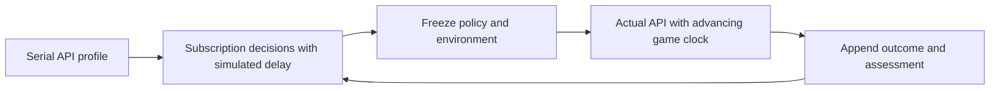

# Rhythm: SOL learns to act before the deadline

A fast-looking answer is useless if the note has already passed. This case
follows the **selected route to the released v21 policy**: SOL makes each online
visual decision, while Codex runs experiments, inspects failures and changes
prompts and permitted environment conditions. Humans supply objectives,
budgets and feedback, including the final 2.5s preview request. The task policy
is trained through interaction, model-authored memory revisions and strategy
search, with base-model weights frozen. This is human-steered autoresearch,
with actual model calls.

The released strategy is an earlier selected candidate, not a claim that the
last development candidate was best. This walkthrough is a curated adopted
lineage, not an exhaustive ledger of every investigation. Original evidence
is linked in the [machine-readable history](../research/rhythm/evaluation-history.jsonl).
Different charts, horizons, API conditions and environment settings are stated;
these rows are not a single controlled benchmark or a monotonic learning curve.

## 1. Make the model own the action

The experiment moved to literal `{id,key,at_ms,expires_ms}` plans. GPT reads the
pixels and computes arrival times. The surrounding program validates and
executes those numbers. A coded pixel-to-time controller can score well, but
would not demonstrate the selected model-owned timing task; that old path is
removed from the active package.

The initial v5 full 30s API trial recorded 18 Perfect,10 Great,4 Good and 20 Miss.
The agent used missed events and public pending/receipt logs to revise identity
and timing instructions. A later v11 full 30s trial reached 37 Perfect,5 Great,
4 Good and 6 Miss. The v19 timing-memory 20s case had 20 Perfect,4 Great,4 Good
and 1 Miss on 29 notes. These were different charts and configurations: they
motivate hypotheses, not a causal percentage-improvement claim.

## 2. Develop cheaply with real decisions under measured delay

Subscription inference supplies new decisions from each simulated screenshot.
The private event loop delays their delivery according to measured API
conditions and keeps an actor occupied until its terminal response would finish.
It can wait for subscription computation without pretending that wall time is
real-time play. Prompts evolve from failures: read higher notes, preserve exact
pending payloads, keep IDs stable, distinguish adjacent eighths and reason from
the image's capture clock rather than response time.

The bounded actor pool overlaps requests on successive screenshots to sustain
decision cadence while earlier requests are still thinking. Each response
predicts future literal tap times; the executor retains pending commands and
applies those times unchanged. This is the throughput/latency distinction
described in [latency-aware learning and control](latency-aware-learning.md).

The selected v21 simulation case completed 52 notes over 30s with 51 Perfect,
1 Good,zero Miss andzero empty presses. A separate real 8s API trial then scored
10/10 Perfect with zero misses or empty presses. This validated the short path,
not a complete-game solve. The same short condition was later reproduced.

## 3. Audit the observation before blaming the model

Longer real trials exposed two independent problems: image content and its
marked timestamp differed, and the export/song grid was not synchronized.
A draw-ID diagnostic painted an identifier into the actual canvas and matched
CDP screenshots to the exact draw. On the original Ubuntu, timestamp-minus-draw
medians were approximately 32,32 and 49ms across launches. The model prompt gained
an explicit approximate 50ms content-time calibration; no executor correction
was added. Audio onset analysis aligned the retained 25-note chart to the song,
and stable audio diagnostics fixed video anchoring. Continuous display capture
was separated from the API observation rate.

With the calibrated 17s chart and 200ms observations, real API evaluation still
had 18 Perfect,2 Great,5 Miss andzero empty presses. Inspection showed correct
planned times arriving too late. A strictly serial 20-input API profile had
16/20 action JSONs below 1.8s,median 1.629s andmaximum 3.136s. Serial calls also
have tails: raising concurrency is not a guarantee of timely delivery.

## 4. Give visual reasoning enough lead

The human requested increasing note approach from 1.8 to 2.5s while preserving
music at 1x. The agent changed only that duration and its public speed
calibration, froze the condition and reran the same 25-note 17s chart at 200ms
cadence. GPT still chose every key, ID and literal time. The new condition is
easier in available visual lead; it is explicitly an environment change, not
a secretly faster model or wider judgment window.

| Native 17s condition | Perfect | Great | Miss | Empty | Weighted accuracy |
| --- | ---: | ---: | ---: | ---: | ---: |
|1.8s approach |18|2|5|0|77.6%|
|2.5s approach, selected |24|1|0|2|98.8%|

The selected run used 85 real API requests with zero errors. Action-ready latency
median 1.421s,SD 0.282s,max 2.400s;cost USD 2.230575. Sources and chart were verified
unchanged through the run. The earlier 30s/52-note development charts differ from this 17s/25-note
demonstration input. For the final approach-duration comparison, both 17s runs
use the same aligned chart, as recorded in the [frozen design](../artifacts/rhythm/selected/source-freeze.json).
This successful near-perfect task demonstration has two empty presses; repeated
success and fresh-chart transfer remain separate measurements.

The remaining errors are visible: the first screenshot still showed GO, and
its first-note plan was early; a second ID clicked that already-hit note again.
Another response misread the upper left slanted D lane as F. The program did
not hide either extra press. Max combo was 15 despite zero misses.

## What makes this autoresearch

The useful loop is not a polished final video. It is an observable chain:
missed deadlines → inspect trajectories → revise model-authored guidance →
simulate new decisions under measured delay → freeze → run actual API → audit
clocks and exceptions → retain a candidate with its known limits. Hypotheses,
source hashes, prompts, complete outcomes and assessment decisions remain
inspectable. The [selected original requests](../artifacts/rhythm/selected/requests.jsonl)
and [result](../artifacts/rhythm/selected/result.json) accompany the video.

The package preserves other games. Inactive Rhythm timing controllers, SSH
launchers and unselected policy copies are removed from the active tree; git
history retains them. [Run and extend the experiment](rhythm.md).
