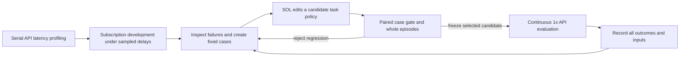

# SOL researches a realtime Touhou policy

The selected controller is **`tracking_dodge_safe_intercept_v2`**, an early checkpoint that earned promotion through a fixed development gate and live API evaluation. The release follows that checkpoint. A larger version number is not the selection criterion.

SOL sees chronological screenshots and its own previously returned controls, then chooses every direction, Z/Shift/X key and duration. The game keeps advancing during API inference. There is no target servo, coded dodge, automatic bomb or prerecorded action script in a live evaluation. `player`, `boss` and `aim_x` are the model's visual estimates for auditing; the executor consumes only `plan`.

This is a **source-harness realtime API** demonstration: seed 1, 1×, native English public summaries, 58.47 game seconds to defeat, two hits. Its [audit](../artifacts/touhou/records/v2-live-en-race4.json) retains the selected public answers, their input hashes and actual application timing; complete historical inputs and candidate responses remain in the original research workspace; this PR publishes the compact audit and original video. The sentence and action came from the same response. It is a short public decision summary, not a hidden reasoning trace. Video encoding and BGM were added afterward; the gameplay and summaries were recorded live. See the [evidence index](../artifacts/README.md) for the optional original video.

## Research loop

The human supplied the task, spending limit, behavior feedback, a demonstrated trajectory and review. SOL implemented the environment/harness, inspected recorded failures, formulated candidate prompt changes, collected subscription answers, evaluated the fixed cases and ran the API tests. This is agent-driven prompt research with human guidance; it does not train model weights or claim an experiment without human input.

### 1. Establish timing before interpreting scores

Early 1× development rounds repeatedly lost or survived without defeating the boss. Named action fields and strict JSON addressed invalid compact actions. Temporal grounding addressed confusing an old shot column with the current player. Preventive bombs addressed decisions arriving after an imminent collision. Historical [interim results](../environments/touhou/research/RESULTS.md) retain these failures.

The first frozen single-action realtime attempt lost at 53.98 game seconds with 450 boss HP remaining despite 25 valid requests. A single earlier simulated win had not survived confirmation. This motivated further research instead of declaring success.

Profiling used **serial API calls** on varied retained observations. Development used actual subscription model answers, while the simulator imposed a recorded delay condition. When a subscription answer took longer to compute, virtual game time waited at its scheduled delivery event. Wall-clock subscription time was recorded separately. A simulated win was therefore evidence for a candidate, not realtime acceptance.

In the race controller, complete legal JSON can apply before a response's terminal event. The losing responses must still drain and settle. Their slots and fee reservations remain occupied until then. Readiness, terminal occupancy and mechanical application are separate events.

### 2. Turn “follow Kaguya and dodge” into a development set

The observed problem was delayed chasing: the player moved toward Kaguya's old x-position after she had already reversed. Long empty firing intervals and late defensive actions exposed distinct failures. The fixed set contained **12 cases: eight from an earlier model run and four from verified human play**.

Each answer was checked from the same private replay prefix at two fixed delays, 2.69135 and 3.170205 seconds, followed by 180 logical ticks. Scores measured actual ordinary-shot damage; bomb damage, empty firing intervals, deaths, hits and resources were tracked separately. This scoring lives in the offline evaluator and **does not change the game's Gym reward**. Private future frames, engine positions, labels and future human keys never enter actor prompts.

### 3. Reject a tempting regression

Round one collected three policies × 12 cases × two independent answers: 72 subscription decisions and 144 delayed rollouts. Intercept and turn-guard candidates increased mean shot damage by about 5.8% and 11.4%, but hits increased from 2 to 4 and 6. Both failed the predeclared safety gate; the baseline remained selected.

SOL's diagnosis covered three periods: the action's start after inference, the movement path, and the stopped firing position while awaiting the next answer. A stationary action also needed the safety check. Improving an intercept while leaving the player in a closing gap was insufficient.

### 4. Promote the compact v2 change

V2 kept the compact delayed-intercept/turn heuristic and added that whole-interval safety veto. On the second frozen case collection, ordinary-shot damage rose from 101.875 to 105.9375 (+3.99%), hits changed from 8 to 7, and bombs stayed at 8. `safe_intercept_v2` passed the gate. The [frozen hypotheses](../environments/touhou/research/TRACKING_POLICY_V2.md) and [results](../environments/touhou/research/TRACKING_RESULTS.md) document the decision.

Whole development episodes then used seeds 9/10 with matched delay random numbers. The old adaptive policy did not defeat either boss, leaving 470/175 HP. V2 defeated both at 59.97/50.38 game seconds with two hits each. These were **2/2 subscription/profile simulation wins**, not API wins. The two case rounds plus the whole-episode comparison used 448 game-policy subscription calls.

The small correlated set and stochastic baseline matter: baseline hits differed between the two case collections. The roughly 4% damage change is a selection result, not a statistically established improvement or generalization claim.

### 5. Freeze the task, calibrate serially, then evaluate live

The finalist's complete task inputs were frozen before 21 serial API calibration calls. All were legal. Among 19 three-image samples, complete legal JSON readiness was fastest 1.467s, median 2.283s and P95 2.955s. The one- and two-image strata had one sample each. Mapping that marginal timing into earlier race/terminal cohorts was explicitly modeled; it was not new concurrent calibration.

The original selected-v2 API run defeated the boss in **51.05 game seconds**, with two hits and all responses accounted. Later demonstration runs retained the same gameplay strategy while adding short public summaries. English is generated directly by GPT; it is not a translation step. The active task generator matches the original live source on a retained compatibility fixture, and historical prompt hashes avoid depending on the old machine's Git objects.

## Evaluation outcomes

The append-only [record index](../artifacts/touhou/evaluations.jsonl) is authoritative. Historical source-harness runs and fresh portable CLI runs are separate provenance classes.

| Run | Execution | Result | Actual capture→apply median | Requests / actions | Cost |
|---|---|---|---:|---:|---:|
| Original selected v2 | Actual API, seed 1, 1× | Defeat 51.05s; 2 hits | See original report | 80 / 19 | $1.86 |
| Public Chinese summary, four-way | Actual API, seed 1, 1× | Defeat 45.80s; 1 hit | 2.43s | 68 / 16 | $1.68 |
| Native English, two-way | Actual API, seed 1, 1× | Survived 60s; boss 155 HP; 1 hit | 2.32s | 42 / 20 | $1.56 |
| Native English, four-way | Actual API, seed 1, 1× | Defeat 58.47s; 2 hits | 2.35s | 72 / 18 | $1.74 |
| Previous portable simulation | Subscription + historical timing, seed 9 | Loss 48.82s; boss 260 HP | Not actual API timing | 68 / 16 | Subscription |

An earlier English four-way attempt was interrupted by conservative budget admission. Its 30 billed calls and $0.6976908 cost are retained separately; two rejected admissions were never billed. It has no completed game outcome and is not counted as a policy loss. The two-/four-way comparison above is one episode per condition: it did not establish a median-latency benefit or a stable win-rate improvement. Seed1 is a development/demo seed, not held out.

Fresh CLI validation is appended to the index rather than replacing the previous portable loss or retroactively relabeling these source-harness results.

## What is frozen and what is allowed to improve

The [selected policy](../policies/touhou/tracking-safe-intercept-v2/policy.txt), [simulation recipe](../recipes/touhou.json), [realtime recipe](../recipes/touhou-realtime.json), engine hash and per-run source snapshots identify each condition. The selected engine hash is `348e81340d4a09f8b488193daf0b4e395afa2755d34f249585ff5e1ffe787aa4`.

A research iteration can change the candidate prompt, action chunking or request scheduling, but must label the condition, keep every action model-authored, retain the baseline, and score both failures and wins. Do not add hidden-state assistance or turn retrospective action replay into realtime evidence. Use [the development workflow](touhou-development.md) and [evaluation-record instructions](evaluation-records.md).
